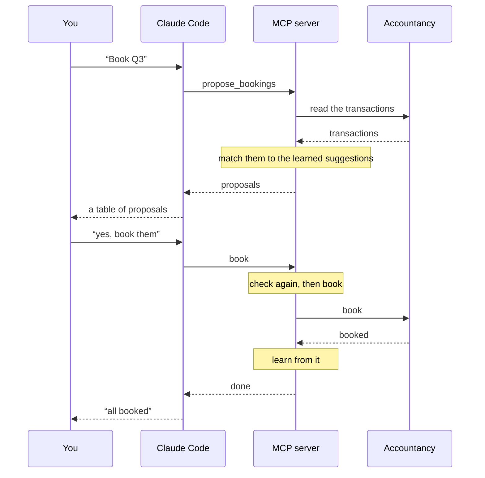

Every quarter I sit down to book my bank transactions. I run a one-person company, so it's not a mountain of work, but it's the dullest kind of work there is: a long list of lines, and for each one the same two questions. Which category? Which VAT rate? The phone bill is telecom at 21%, again. The train ticket is travel at 9%, again. The insurance is VAT-free, again.

My accountancy software has a web app for this, and it's fine. But it makes me click through every single line, and it doesn't really remember what I taught it the quarter before. After years of history, *I* know what every counterparty is. The software just doesn't seem to.

So I built an MCP server that lets Claude Code do the dull part, while I do the part that actually needs me: saying yes.

## MCP in one paragraph

MCP, the Model Context Protocol, is a way to give an LLM tools. You write a small server that offers a handful of functions, each with a name, typed arguments and a description in plain words, and an MCP client like Claude Code can call them in the middle of a conversation. That's it. No plugin store, no SaaS integration, no permission from anyone. If you can reach something from code, you can hand it to Claude.

Mine is a Python server of a couple of thousand lines, started by Claude Code from a `.mcp.json` in the project folder. It talks to my accountancy software over the same HTTP API its web app uses, and it keeps what it learns in one YAML file on my disk.

## How a booking flows

Here's a simplified picture of a quarter being booked. Three parties, and one rule: nothing gets written until I've said yes.



What's going on:

- **Claude Code** is the conversation. It decides which tool to call, shows me the results as tables, and asks before anything gets written.
- **The MCP server** holds the rules. It reads from the accountancy software, matches against what it has learned, and refuses anything that doesn't add up. A booking for a transaction it didn't just propose, for example, or one that was booked in the web app in the meantime.
- **The accountancy software** stays the source of truth. The server checks it again right before every booking, so nothing gets booked twice.

The nice part about this split: Claude is great at the conversation ("that one's a business lunch, not groceries") and terrible at being trusted blindly with money. The server is the other way around. Together they make a pretty good bookkeeper.

## Learning the suggestions

The heart of it is a file of learned suggestions: one entry per counterparty, with every booking it was learned from.

I seeded it once from the full booking history. The server read how each transaction was booked and grouped them by counterparty, by IBAN where there is one and by name where there isn't. Most counterparties had been booked the same way every time. The ones that hadn't got flagged, and I picked one category and VAT rate for each, or marked it *always ask*. A transfer between my own accounts is the classic always-ask: it can be a dozen different things.

From then on, every booking teaches it something:

- **The latest choice wins.** If the phone bill moves from one category to another, next quarter proposes the new one, and the evidence says so: *"now Telecom since 2026-10-01 (booked this way 1 time in all); before that 14 times as Office costs"*.
- **An IBAN match is confident, a name match is not.** Confident proposals come as one table I can approve in one go. The uncertain ones come one at a time.
- **Patterns cover what has no IBAN or name.** Bank fees, for instance: a description containing a given text gets a given category.

One thing I didn't see coming: payment providers. A streaming service, an airline and an app store can all reach your account through the same payment provider's IBAN, so "match by IBAN" happily proposed one merchant's category for another. The fix was a short list of provider IBANs, on which the server matches by merchant name instead. When a learned IBAN suddenly shows up under a name that looks like a different party, the proposal now carries a hint: *this may be a payment provider*.

## Splitting the credit card statement

The credit card is the worst part of any quarter. On the bank account it's one line: *card collection*, one amount. Behind it are a few dozen purchases, each with its own category and VAT rate.

Now I drag the card statement's CSV into the terminal and say "split this". The server:

1. reads the statement and finds the one unbooked bank transaction its purchases add up to;
2. leaves out what isn't a purchase, like the payment row, or a refund paired with the purchase it cancels;
3. proposes a category and VAT rate for every line, learned per merchant, just like the bank side.

For a merchant it has never seen, Claude follows a rule I gave it: outside the EU, no Dutch VAT. Inside the EU, 21%. I go through the lines, correct a few, and say yes.

Booking a split takes many requests: one booking per line, each with its own amount. If one of them fails halfway, I'd be left with a half-split collection. So it's all or nothing: when anything goes wrong, every booking made in that call is deleted again. The server then checks what is actually left on the collection, rather than assuming.

The statement also has columns I never want to see in a chat window: the card number, the account number, the name on the card. The server reads past them and never keeps them, so they can't end up in Claude's context either.

## Linking the receipts

The last chore is receipts. The accountancy software already reads the amount and date from every receipt I upload. It just doesn't link them. So `propose_receipts` matches unlinked receipts to expenses by amount and date, including the individual lines of a split card collection.

A match is only proposed as confident when nothing else could fit it. Two taxi rides of the same amount in the same week? That's an ambiguous group, and I pick. Anything that matches nothing is listed separately, so I know what's still missing.

## Guardrails, because it's money

None of this works if I can't trust it, so a few rules are built into the server itself, not just the conversation:

- **Every write needs my yes.** The tools that write say so in their descriptions, and only accept what the latest proposal contained.
- **Nothing is retried blindly.** If a booking request times out, nobody knows whether it went through, so the server reports *unknown* and tells me where to look.
- **Secrets stay out of the chat.** The session cookie lives in `.env`, error messages never quote a request, and the server's logs carry no IDs, amounts or IBANs.
- **Undo exists.** `undo_booking` deletes a booking and takes back what it taught the suggestions.

## What this is really about

I didn't set out to build an AI product. I set out to stop clicking through hundreds of lines a quarter. What surprised me is how *little* it took. My accountancy software never had to offer an integration. Claude Code didn't need a plugin. A couple of thousand lines of my own code, written to my own rules (my VAT rule for foreign merchants, my always-ask list, my "never show the card number"), was enough to turn a chore into a five-minute conversation.

And that's the bit I want to leave you with. MCP isn't only for big platforms wiring up their APIs. It's just as much for the small, personal, slightly annoying things only you have. Your energy meter's export. The spreadsheet you update every month. The home automation you keep meaning to script. The photo library you keep meaning to sort. If there's a chore you do the same way every time, and you can reach the data from code, you can give it to an LLM as a tool, with your rules around it.

## The cheat sheet

The tools my server offers, by what they're for:

```text
# Look up
list_categories, list_vat_codes      what the software offers
list_suggestions                     what has been learned, grouped

# Learn
seed_suggestions, save_suggestions   once, from the whole history
relearn_providers                    after listing a payment provider

# Propose (never write)
propose_bookings                     a period's bank transactions
propose_split                        a credit card statement
propose_receipts                     unlinked receipts to expenses

# Write (only after a yes)
book, book_split, link_receipts
undo_booking                         and take back what it learned
```

That's it. My quarterly bookkeeping is now me typing "book Q3", reading a table, and saying yes. My accountant hasn't noticed a thing. Which, for bookkeeping, is exactly the point.
