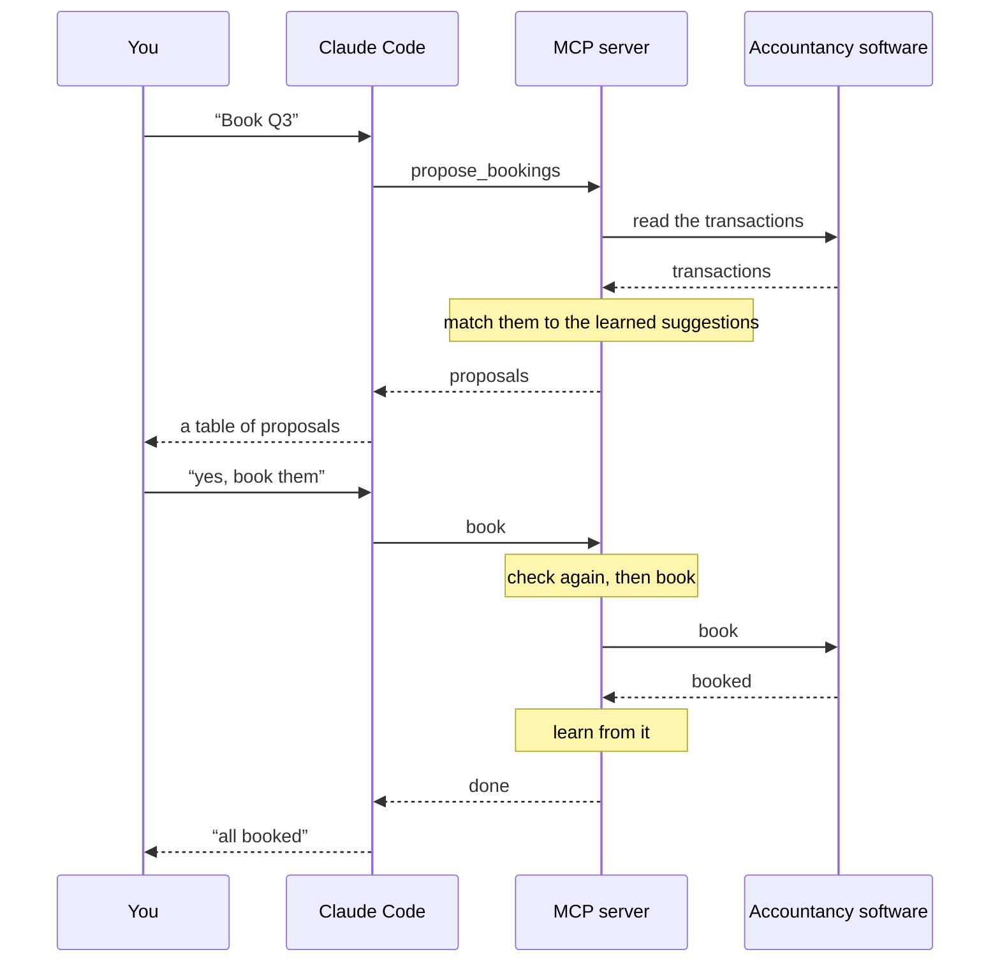

# Mermaid diagrams in posts, drawn at build time

Status: approved in conversation on 2026-10-19, for story #88.

## Purpose

"Letting Claude do my bookkeeping" (`content/posts/letting-claude-do-my-bookkeeping.md`, not yet committed) was written with a Mermaid sequence diagram in mind for its "How a booking flows" section. Posts can't render Mermaid, so the diagram ships as a ` ```text ` block of box-drawing characters: wider than a phone screen, and meaningless to a screen reader.

A fenced ` ```mermaid ` block in a post should become a real diagram.

Success means:
- the diagram is in the static HTML, there the instant the page loads, with no JavaScript;
- it follows the site's theme (colors and fonts), including a theme switch on the open page;
- it fits the 640px column and a phone;
- adding a diagram to a post needs no code;
- CI stays as it is: no browser to install, no noticeable slowdown.

## Non-goals and anti-goals

- **No rendering in the reader's browser.** The site is statically rendered, and that isn't compromised: no `mermaid` bundle, no flash of an undrawn diagram. Koen ruled this out.
- **No headless browser in the build.** `rehype-mermaid` and `@mermaid-js/mermaid-cli` render with the real Mermaid, but need Playwright or Puppeteer and a Chromium, locally and in CI.
- **Not every Mermaid diagram type.** Pie, Gantt, mindmap and the like aren't supported (see "Renderer").
- Interactive diagrams (zoom, pan, clickable nodes) are out of scope.

## Decisions

| Topic         | Decision                                                                                                                                                                                                                                                                                                                                                                                                 |
| ------------- | -------------------------------------------------------------------------------------------------------------------------------------------------------------------------------------------------------------------------------------------------------------------------------------------------------------------------------------------------------------------------------------------------------- |
| Renderer      | [`beautiful-mermaid`](https://github.com/lukilabs/beautiful-mermaid) (MIT, 1.x), pinned to an exact version. Pure JavaScript, no DOM: renders an SVG string synchronously, in about a millisecond for the bookkeeping diagram                                                                                                                                                                            |
| Where         | A rehype plugin in the posts pipeline (`src/lib/posts.ts`), running before Shiki, so ` ```mermaid ` fences never reach the highlighter                                                                                                                                                                                                                                                                   |
| Theming       | Colors passed as the site's CSS variables (`bg: var(--background)`, `fg: var(--foreground)`, `muted: var(--muted-foreground)`, `transparent: true`). The SVG resolves them from the page, so the `dark` class recolors it without re-rendering, and only one SVG is emitted                                                                                                                              |
| Font          | The site's `sans` font (Lausanne), set from `globals.css`. The renderer sizes boxes with its own character-width estimate tuned for Inter, a proportional font; the mono font is wider and would spill out of the boxes. Every Google Fonts `@import` in the SVG is removed (class and ER diagrams add a second one), so there's no third-party request. _My call, after the builder check._             |
| Size          | The SVG is shown at its natural size, never scaled down. When it's wider than the column (on a phone), the `figure` scrolls sideways inside itself (`overflow-x: auto`), like a code block; the page never scrolls. Shrinking the bookkeeping diagram to a phone would put its text at 6–7px. Koen chose this. On a wide screen it's centred in the column; a diagram wider than 640px scrolls there too |
| Accessibility | Required `accTitle:` in every diagram, optional `accDescr:` (Mermaid's own syntax). The plugin reads and removes them before rendering, since the renderer ignores them, and puts them on the SVG as `role="img"` with `<title>` and `<desc>`                                                                                                                                                            |
| Ids           | Every `id` inside an SVG (the `<title>`, `<desc>` and the renderer's arrow markers, such as `seq-arrow`) gets a prefix unique to the diagram in the post, and every `url(#…)` and `href="#…"` reference is rewritten to match, so two diagrams in one post are valid HTML and each uses its own markers. _My call._                                                                                      |
| Errors        | A diagram the renderer rejects (unknown or unsupported diagram type) or one without `accTitle` fails the build with the post's file name, like other broken posts. A malformed line inside a valid diagram is dropped silently by the renderer: accepted, Koen is responsible for checking his own posts                                                                                                 |

### Renderer

`beautiful-mermaid` is not Mermaid: it's an independent parser and layout (ELK) for flowcharts, state, sequence, class and ER diagrams and XY charts. It was chosen over a browser-based renderer because it keeps the build browser-free, and its CSS-variable theming makes the diagram follow the theme without a second render. The trade-offs, accepted:

- its parser is more forgiving than Mermaid's (silent drops, above);
- its drawings look like its own style, not Mermaid's default (which is no loss: the site restyles them anyway);
- a diagram type it doesn't support can't be used in a post.

A spike on 2026-10-19 rendered the bookkeeping diagram to an 11 KB SVG, 646 × 645 at natural size.

## Units

### `src/lib/rehype-mermaid.ts`

A rehype plugin (`(): (tree: Root, file: VFile) => void`), Node and browser safe but only used by `posts.ts`.

- Finds every `pre > code` whose class list contains `language-mermaid` (as `remark-rehype` emits it).
- Reads the code text, splits off `accTitle:` and `accDescr:` lines (single-line forms only), and renders the rest with `renderMermaidSVG`, with the options under "Theming".
- Removes every `@import` from the SVG's `<style>`, and the `font-family` rule it generates, so the site's CSS sets the font. The library's `<style>` rules aren't scoped (`svg { --_… }` applies to every SVG on the page, Lucide icons included); they only set private variables, so that's harmless and left as is.
- Parses the SVG string into hast (`hast-util-from-html`, as a fragment, in the SVG space), adds `role="img"`, `aria-labelledby`/`aria-describedby` pointing at a `<title>` and `<desc>` it inserts as the SVG's first children, and prefixes every id with one unique to the diagram (for example `mermaid-1-`), rewriting the references to them.
- Replaces the `<pre>` with `<figure class="mermaid">` holding the SVG.
- Throws on a render error or a missing `accTitle`. `posts.ts` wraps the message with the file name (`<slug>.md: …`), as it does for front matter.

Whether the plugin itself or a small function it calls (`renderDiagram(source): Element`) holds the rendering is left to the builder.

### `src/lib/posts.ts`

Adds `.use(rehypeMermaid)` between `remarkRehype` and `rehypeShiki`, and turns a plugin error into one naming the post's file.

### `src/components/post-content.tsx`

No change expected: the diagram is a `<figure>`, not a `<pre>`, so it doesn't become a `CodeBlock`. If `hast-util-to-jsx-runtime` needs the SVG's attributes in a particular space, the builder sets that in the plugin.

### Styling in `src/app/globals.css`

Inside `@utility prose`, or beside the `.shiki` rules:

- `figure.mermaid` has the prose block margins, `overflow-x: auto`, and no `secondary` background (a diagram isn't code).
- `.mermaid svg` is `display: block; max-width: none; margin-inline: auto`, at the width and height the renderer gives it.
- `.mermaid text` uses `font-family: var(--font-sans)`.

### The post

`content/posts/letting-claude-do-my-bookkeeping.md` replaces its ` ```text ` diagram (and only that block; the cheat sheet at the end is a list, not a diagram, and stays) with:

````markdown

````

The messages you type are in curly quotes: the renderer drops straight double quotes. The post is committed with this story, otherwise unchanged.

### `CLAUDE.md`

The "Posts" paragraph mentions diagrams: ` ```mermaid ` fences are drawn at build time by `beautiful-mermaid` with the site's tokens, need an `accTitle`, and which diagram types work.

## Testing

- **`src/lib/rehype-mermaid.test.ts`**, on small Markdown strings through the same unified pipeline:
  - a `mermaid` fence becomes `figure.mermaid > svg` with `role="img"`, the `<title>` and `<desc>` from `accTitle`/`accDescr`, and no `<pre>`;
  - the SVG's colors are the site's variables (`var(--background)`, `var(--foreground)`), and it has no `@import` (checked with a class diagram too);
  - two diagrams in one post get different ids, and each one's arrows point at its own markers;
  - curly quotes in a message survive;
  - a fence without `accTitle` throws, and so does an unsupported type (`pie`);
  - a `text` fence still comes out as a Shiki `pre`.
- **`src/lib/posts.test.ts`:** a fixture post with a diagram renders it, and a fixture with a broken diagram fails with its file name.
- **Build:** `npm run build`; `out/posts/letting-claude-do-my-bookkeeping/index.html` contains the inline SVG and no `mermaid` script.
- **Browser** (`npx serve out`): the post in light and dark, switching on the open page; on a wide screen (centred, in Lausanne, labels inside their boxes) and a phone width (full size, scrolling sideways inside its figure, the page not scrolling); the page loads no extra requests for it.

## Left to the builder

- The plugin's internal structure and file name, and whether it lives in `src/lib/` or beside `posts.ts` under another name.
- How the `@import` and font rule are removed (string replace before parsing, or on the hast).
- Whether `hast-util-from-html` or another hast parser is used, as long as it's a small, maintained unified package.
- A Storybook story isn't needed: the diagram isn't a React component, and Storybook can't import `posts.ts`.
